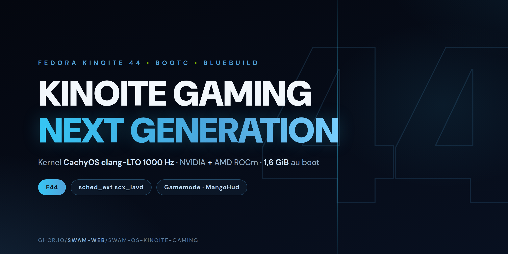

# SwamOS — kinoite-gaming

A **universal** **bootc** (Fedora Atomic) image based on **official Kinoite**
(`quay.io/fedora-ostree-desktops/kinoite:44`), built with
[BlueBuild](https://blue-build.org/). It is the **fusion** of
[`swam-os-kinoite-nvidia`](https://github.com/Swam-web/swam-os-kinoite) and
`swam-os-kinoite-amd`: **both GPU stacks live in the same image**, the hardware
decides at boot, with zero questions or configuration.

**Identity**: stock Fedora/Kinoite — the SwamOS rebadge (os-release, SDDM,
fastfetch) was reverted (commit `c4790e1`).

- **Base**: `quay.io/fedora-ostree-desktops/kinoite`, version `44`
- **Published image**: `ghcr.io/swam-web/swam-os-kinoite-gaming:latest`

## Why a universal image

| Hardware | What happens |
|---|---|
| NVIDIA | `nvidia.ko` (clang-built akmod) loads, `nouveau` blacklisted; ROCm present but inert |
| AMD | in-tree `amdgpu` (CachyOS kernel) loads; the NVIDIA stack is inert |
| Hybrid laptop (AMD iGPU + NVIDIA dGPU) | Both load and cooperate — impossible with two separate images |

## What's inside

| | Detail |
|---|---|
| **Kernel** | CachyOS `kernel-cachyos-lto` (Clang LTO, 1000 Hz, full preempt) — COPR `bieszczaders/kernel-cachyos-lto`, replaces the Fedora kernel (`install-kernel-akmods` pattern) |
| **NVIDIA (RPMFusion)** | `akmod-nvidia` + userland `xorg-x11-drv-nvidia` (`.i686` included), kmods rebuilt with **clang** against the CachyOS kernel (`pahole` + `xorg-x11-drv-nvidia-kmodsrc`) |
| **AMD ROCm (minimal gaming)** | Official AMD repo (RHEL9): `rocm-core`, `rocm-opencl-runtime`, `rocm-smi` — installed via the BlueBuild optfix (`/usr/lib/opt`, `/opt` symlinks at boot). **No HIP stack** (`rocm-hip-runtime`, `rocm-libs`/rocBLAS ≈ 5-6 GB): useless for gaming (Vulkan/DXVK via mesa) — if you need it: `rpm-ostree install rocm-hip-runtime rocm-libs` |
| **MT7927 WiFi/BT** | `mt7925e`/`mt76` + `btusb`/`btmtk` prebuilt (jetm/mediatek-mt7927-dkms v2.16, clang) against the CachyOS kernel; BT firmware `MT6639` bundled (missing from linux-firmware) |
| **Universal codecs** | RPMFusion: full ffmpeg, `@multimedia`, openh264, libdvdcss; VA-API/Vulkan **AMD** (`mesa-*-freeworld`) **and** NVIDIA NVDEC→VA-API bridge (`libva-nvidia-driver`); full 32-bit |
| **Gaming** | gamescope, gamemode, mangohud, vkBasalt, goverlay, steam-devices (RPM); Steam, Lutris, Heroic, Bottles, OBS, **BoxBuddy** (distrobox GUI)… (Flathub, `default-flatpaks`); **flatpak VulkanLayer** MangoHud/gamescope/vkBasalt (refs pinned to 25.08/26.08 — RPM layers don't reach flatpak games) |
| **Peripherals (fail-soft)** | **xpadneo** (Xbox BT controllers, advanced rumble), **xone** (Xbox USB dongle + firmware), **OpenRazer** (clang kmods + daemon), **OpenTabletDriver** (tablets), `libcec` (HDMI CEC via Pulse-Eight adapter) — a failed source doesn't kill the build |
| **Responsiveness (CachyOS base)** | `scx_lavd` (sched_ext, auto Gaming mode), `ananicy-cpp`, zram + `cachyos-settings` sysctls; **`game-performance`** (provided by `cachyos-settings`): `powerprofilesctl` performance on app launch — add it to Steam launch options (`game-performance %command%`) for games outside gamemode |
| **Gaming tuning** | `gamemode.ini` (renice -10 via PAM limits `limits.d/swam-gamemode.conf`, performance governor); PipeWire quantum **256** (~5.3 ms); sysctl **BBR + fq + `vm.max_map_count`** (absent from `cachyos-settings`); Plasma animations ÷2 (`kdeglobals` /etc/xdg); `thermald` (Intel, inert on AMD); karg `nvidia-drm.fbdev=1` |
| **Lightweight** | Baloo (indexer) masked, `irqbalance` and `plasma-discover` removed, `cups`/`avahi` **socket-activated**, KWin `AllowTearing`, btrfs `zstd` compression |
| **Data snapshots** | `snapper` (hourly timeline on `/var/home`, config created on first boot by `swam-snapper-setup.service`, progressive pruning) + **Btrfs Assistant** (GUI: browse/restore) + `btrfsmaintenance` (scrub/balance). Fine-grained data recovery — **not a backup** (same disk); the OS itself is versioned by ostree (`rpm-ostree rollback`) |

## Installation

```bash
sudo bootc switch ghcr.io/swam-web/swam-os-kinoite-gaming:latest
sudo systemctl reboot
```

## Caveats

- **Secure Boot**: the CachyOS kernel and built modules are not signed by a
  Microsoft-approved key. Disable Secure Boot, or enroll your own MOK key.
- The **NVIDIA open** driver supports **Turing (RTX 20) and newer**.
- On **AMD-only** machines, the initramfs forces `nvidia.ko` which finds no hardware:
  a benign boot warning, no effect.
- **MT7927 (WiFi/BT)**: prebuilt modules jetm/mediatek-mt7927-dkms v2.16
  against the CachyOS kernel (clang) + bundled BT firmware `BT_RAM_CODE_MT6639`.
  The driver was once removed (2026-10) as a suspect in the user-profile
  corruption saga; it was **cleared** (identical crash with or without it)
  and is back in the image.
- `tsc=reliable clocksource=tsc`: remove these kargs if you hit clock drift (exotic VMs).
- `clearcpuid=514`: masks CPUID feature 514 — **required to launch some games**
  (Proton/Wine). Only remove it knowingly.
- `mitigations=off` is deliberately **not enabled** (see the comment in `recipe.yml`).

## Build

```bash
# container image
sudo -E nix run github:blue-build/cli -- build recipe recipes/recipe.yml

# validation only (fast)
bluebuild validate recipes/recipe.yml
```

## Disk images (ISO / qcow2)

Via **bootc-image-builder** (read the caveat in the `swam-os-kinoite-nvidia` repo about
`bluebuild generate-iso` limitations):

```bash
sudo podman run --rm --privileged --pull=newer \
  -v ./output:/output \
  -v /var/lib/containers/storage:/var/lib/containers/storage \
  quay.io/centos-bootc/bootc-image-builder:latest \
  --type anaconda-iso \
  --config ./disk_config/iso.toml \
  --local --chown $(id -u):$(id -g) \
  ghcr.io/swam-web/swam-os-kinoite-gaming:latest
```

Or via GitHub Actions: `Actions → Build disk images → Run workflow`
(set `release-tag`, e.g. `v44.0`, to publish the ISO to Releases — public download).

## Signing

Images are signed with **cosign** (public key in `cosign.pub`, GitHub secret `SIGNING_SECRET`).

```bash
cosign verify --key cosign.pub ghcr.io/swam-web/swam-os-kinoite-gaming:latest
```

## Credits

[Fedora Kinoite](https://fedoraproject.org/kinoite/) / [Universal Blue](https://universal-blue.org/),
[BlueBuild](https://blue-build.org/), [CachyOS](https://cachyos.org/), [RPMFusion](https://rpmfusion.org/),
[AMD ROCm](https://www.amd.com/en/developer/resources/rocm-hub.html),
[jetm/mediatek-mt7927-dkms](https://github.com/jetm/mediatek-mt7927-dkms).
